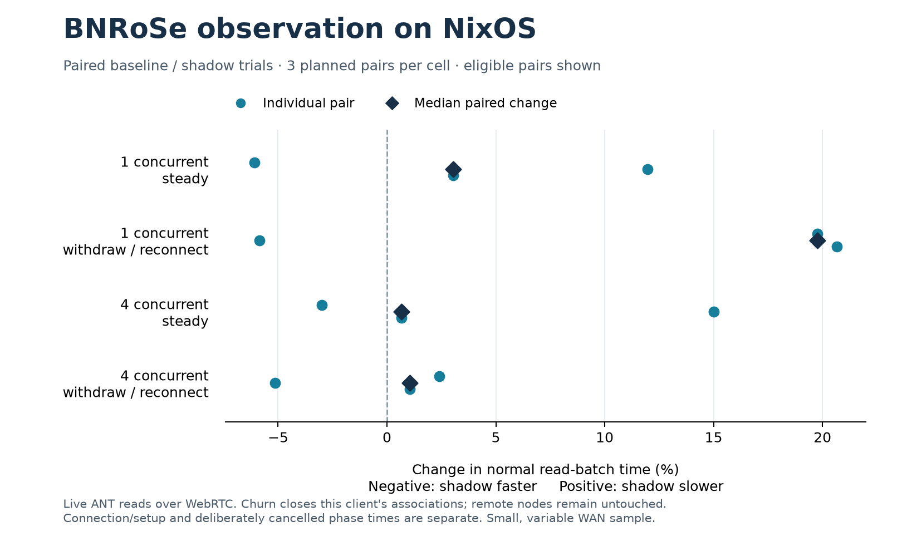
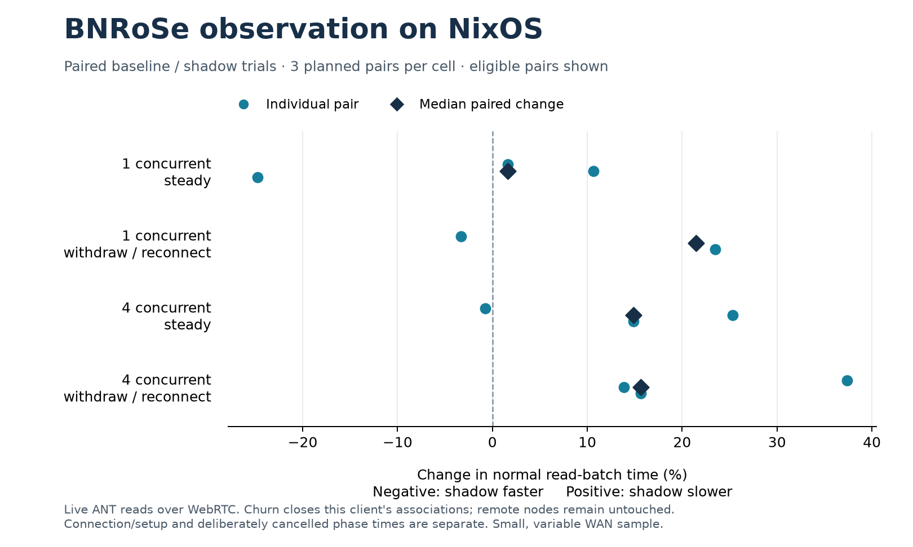

# ANT WebRTC observation and NixOS comparison

Work is isolated on `codex/ant-bnrose-observation`, based on
`eb408fa8b6af72462328055c147d0995318a7332`. x0x PR #4 remains open and unmerged.
The invitation repair, dependency audit and Oracle capacity constraint remain
separate lanes.

The new `tools/ant-bnrose/` experiment invokes the existing Rust
`bnrose-exec-core` through its import-free WASM adapter after the unchanged
Autonomi SDK download and independent expected-content hash verification.
It grants no routing, execution, wallet, payment or DAO authority.

## Follow-up result: local cost reduced; live slowdown remains variable

PR #478's initial `BNROSE-RUST-001` run
[`39463132586`](https://github.com/beehive-nature/beehive-nature/actions/runs/39463132586)
passed all four jobs at `1f351dcde2e4151495838cd4953c82f2f5338ddc`.
The broader CI suite was still running when this follow-up began.

The observer previously allocated and encoded its fixed policy and envelope
fields on every completion. `observation-request.mjs` now builds one template
per reader, updating only the timestamp, sequence and verified content hash.
The existing Rust WASM, SDK, hash verification, admission function, cancellation
rules and autonomy boundaries are unchanged. Nine tests passed on NixOS,
including exact old/new wire-byte agreement across time/hash changes and
sequence carries. Existing concurrent-completion and tampering tests still pass.

Three local Chromium trials on the same NixOS host measured 7,500 reads per
arm per trial after warmup. In balanced order, the optimized observer reduced
total measured observation time by **62.53–63.30%** relative to the parent
implementation. Whole local verified-read blocks improved **19.57–20.94%**
(median paired block change per trial). All reads still performed full SHA-256
verification and every shadow completion reached the real Rust admission core.
This isolates the JavaScript adapter's allocations; the Rust kernel is not
changed. The median block-averaged observation cost fell from 40.0–43.0
microseconds to 14.8–16.8 microseconds. Optimized whole local reads still cost
112.4–117.0 microseconds versus baseline's 96.2–98.0 microseconds (medians of
block means). Loopback HTTP/CDP serves and measures this experiment; it does
not invoke the ANT SDK or contact storage peers.

The three full component receipts, all measured blocks and analysis are in
[`comparison-template-cost.json`](../receipts/ant-bnrose-2026-10-20/comparison-template-cost.json)
and `template-cost-r{1,2,3}.json`. The parent observer is extracted byte-for-byte
from `1f351dcde2e4151495838cd4953c82f2f5338ddc`; its digest is checked
alongside the unchanged Rust 1.98.1 kernel and SDK. No warmup is presented as
a measured sample, and no failed or slow block was removed.

The live network driver is **`18d0e70210499b894d9e7804c7bf87111b64b614`**.
All 62 selected input files matched their Git blobs at the start check and
after the run. It used the same NixOS host, pinned runtime, original matrix,
fixtures, timeouts, serial ordering and withdrawal behavior as the prior pass.
The 24 trials ran **17:30:05–17:43:54 UTC** on October 20:

- **150 verified completed reads**, 30 deliberately cancelled reads,
  **zero unexpected failures**; all 24 trials complete.
- **75/75** successful shadow completions observed, no refusals or errors.
- **12/12** active in-flight withdrawals and **12/12** complete authenticated
  network recoveries.
- **60/60** normal phases verified with received bytes and a selected direct
  UDP path; no relay candidate among 1,860 repeated path observations.

| Concurrent reads | Condition | Prior paired median | New paired median | New individual-pair range |
| --- | --- | ---: | ---: | ---: |
| 1 | steady | +1.61% | **+3.04%** | -6.08% to +11.96% |
| 1 | withdrawal/reconnect | +21.48% | **+19.77%** | -5.86% to +20.66% |
| 4 | steady | +14.88% | **+0.66%** | -2.99% to +15.00% |
| 4 | withdrawal/reconnect | +15.67% | **+1.06%** | -5.15% to +2.41% |

Positive means slower with shadow; each cell has three pairs. The two passes
ran in different time windows, so the lower high-load differences cannot be
causally attributed to the allocation change. The single-read steady median
worsened and single-read churn still shows a substantial slowdown. There is
**no demonstrated overall live delivery speedup**.

In the live pass the observer took median **0.100 ms**, p95 **1.400 ms**,
maximum **3.700 ms**, total **25.100 ms** across 75 completions. The prior
figures were 0.200 / 1.700 / 2.600 / 32.400 ms. This retains the worse new
maximum; the controlled local experiment is the stronger allocation-cost
comparison. Median wrapper preparation remained 0.350 ms.

The measured time decomposition locates the remaining difference:

| Sum across all 12 paired trials | Prior pass | New pass |
| --- | ---: | ---: |
| Shadow minus baseline normal read-batch time | +37,341.0 ms | +14,248.4 ms |
| Difference in slowest SDK read per normal phase | +37,325.9 ms | +14,238.2 ms |
| Remaining difference outside that SDK interval | +15.1 ms | +10.2 ms |

The SDK interval includes authenticated discovery, reads and scheduling;
the residual includes launch skew, full-file verification, observation and
other JavaScript. This is a location of measured time, not proof of a remote
network cause. The current observer cannot directly change SDK routing or
request counts. Actual work still varies: baseline/shadow received
247,777,374 / 263,430,499 DataChannel bytes, created 1,130 / 1,138 connection
instances and consumed 114.209 / 116.859 aggregate sandbox CPU seconds.
Each arm delivered the same 16,552,230 verified plaintext bytes.

All 27 new raw browser receipts (24 network, three local), sandbox logs,
source manifest, before/after provenance, comparison, time decomposition,
and original/stored digests are committed under
`docs/receipts/ant-bnrose-2026-10-20/`. All original pretty-printed JSON bytes
reconstruct exactly from the compact committed files. The live comparison is
[`comparison-template.json`](../receipts/ant-bnrose-2026-10-20/comparison-template.json);
the old/new time decompositions are `diagnosis-before-template.json` and
`diagnosis-template.json`.

At 17:44:33 UTC production x0x remained active, health HTTP 200,
`NRestarts=0`, with its unchanged October 17 start time. No benchmark unit
remained active. There was no production restart, deployment, new public
listener, firewall change, dependency change, cryptographic bypass, authority
delegation or DAO mutation. No further native Rust rebuild was necessary for
this JavaScript-only optimization; the prior native tests and exact binary
digest are retained, and the new nine-test suite ran against that binary
on NixOS. Hosted CI for the updated PR revision is reported separately.

## Earlier repository-pin result, before allocation reduction

The final network driver was
`5676033ba5480057c88be2e733e8129dd1b1220b`, with
`rustc 1.98.1 (48a229cea 2026-09-01)` matching `rust-toolchain.toml`.
The 24 trials ran from 16:47:27 through 17:00:49 UTC on October 20.
All 56 selected runtime/source inputs matched their Git blobs after the run.
The minimal workspace's 13 surviving package versions and checksums match the
original lock; its compiled lock is unchanged across the two compiler builds.

WASM SHA-256: `3b7ff705ec891be6472206c93107beb52d0c0aee85c44fd377a090cbec77dcbf` — PUBLIC-CONSTANT: measured Rust 1.98.1 artifact.

- **150/150 expected completed reads verified**, plus 30 deliberate
  cancellation outcomes; zero unexpected read failures.
- **75/75 successful shadow reads observed** by the actual Rust admission
  core; zero observation refusals/errors. Baseline had 75 verified reads.
- **12/12 withdrawal interventions** had connected associations, pending reads
  and newly sent DataChannel bytes; **12/12 recovered fully** through fresh
  clients and uncached files.
- **60/60 normal phases** had verified content, received DataChannel bytes and
  selected direct UDP paths. Zero relay candidates appeared among 1,914
  selected-path observations; these are repeated observations, not unique
  peers.

| Concurrent reads | Condition | Median paired read-batch change | Individual pair range |
| --- | --- | ---: | ---: |
| 1 | steady | +1.61% | -24.74% to +10.65% |
| 1 | withdrawal/reconnect | +21.48% | -3.29% to +23.50% |
| 4 | steady | +14.88% | -0.73% to +25.34% |
| 4 | withdrawal/reconnect | +15.67% | +13.86% to +37.38% |

Positive means shadow was slower. All four cell medians were slower in this
pass. The local observer itself took median **0.200 ms**, p95 **1.700 ms**,
maximum **2.600 ms** over 75 completions; median wrapper preparation was
0.350 ms. These component timings do not erase the measured end-to-end
slowdowns or establish their cause. This small, variable WAN sample provides
**no speedup evidence**.

Each arm delivered 16,552,230 verified plaintext bytes. Received DataChannel
traffic was 236,464,129 bytes for baseline and 251,463,014 for shadow, including
discovery, authentication, metadata and repeated chunk reads. The browser
created 1,101 and 1,109 connection instances respectively; these are attempts/
associations, not unique peer counts. Requested workload was paired, while
actual network discovery/path work varied.

The comparison and all 24 underlying outcomes are in
[`comparison-rust198.json`](../receipts/ant-bnrose-2026-10-20/comparison-rust198.json)
and the `matrix5676033ba-*` receipts. The final source/binary check is
[`provenance-rust198.json`](../receipts/ant-bnrose-2026-10-20/provenance-rust198.json).
The production x0x service remained active at the final check, reported
`NRestarts=0`, retained its October 17 start timestamp, and answered health
HTTP 200. No benchmark units remained running.

## Preparation and separately retained Rust 1.95.0 sweep

- Rust 1.95.0 compiled the existing three crates to `wasm32-unknown-unknown`.
  Two inherited warnings remain (`unused_mut` and unused `put_u16`).
- Five Node tests against the actual WASM passed: opt-out, tampering,
  failed transport/cancellation, out-of-order completion and policy snapshot.
- Initial browser launch exposed a relative fixture URL error, corrected
  before the matrix. This failed pilot will be retained.
- A single-file pilot proved a cold direct WebRTC read but subsequent reads
  were SDK cache hits. The final harness uses three different public fixtures.
- The four-concurrent shadow churn pilot completed eight verified reads, all
  eight admitted by the Rust observer. Four pending reads were cancelled
  after 5,605 sent DataChannel bytes with 26 connected associations; a fresh
  client recovered all four audio reads. This is local association withdrawal,
  not remote storage-server loss.

The first complete matrix at source `94b524a760a08ceb0f4e9719d0dfe3e35b39987c`
used Rust 1.95.0. All 24 receipts are retained under
`docs/receipts/ant-bnrose-2026-10-20/` with prefix `matrix94b524a76`:
150 verified deliveries, 30 deliberate cancellations, zero unexpected read
failures, 12/12 active withdrawal interventions and 12/12 full recovery.
Every one of the 60 normal phases had received DataChannel bytes and a selected
direct UDP path. All 75 successful shadow reads reached the Rust observer.
Median observation time was 0.200 ms, p95 1.700 ms, maximum 2.100 ms.

| Concurrent reads | Condition | Median paired change in normal read-batch time |
| --- | --- | ---: |
| 1 | steady | +0.79% |
| 1 | withdrawal/reconnect | +10.94% |
| 4 | steady | -2.68% |
| 4 | withdrawal/reconnect | -14.34% |

These are three pairs per cell. Network variability is much larger than the
observer's own time; these mixed results do not establish a speed improvement.
This is the unchanged Rust ANT SDK in both arms, with optional Rust BNRoSe WASM
admission. It is not a Rust-versus-JavaScript implementation comparison.

The first controller launch lacked a systemd PATH and started no trials.
During the working run, SSH disconnected after the twentieth trial; all
receipts survived. Only the four unexecuted cells were resumed, in the
original order. The final launcher keeps output in the journal to survive SSH
disconnection.

The canonical repository toolchain is Rust 1.98.1. The build now reads that
pin directly; the 1.95.0 sweep remains separately labelled. The 1.98.1 WASM
build passed, along with eight offline JavaScript/WASM boundary and receipt
checks and seven native Rust tests on NixOS. Inherited Rust warnings remain:
`unused_mut`, unused `put_u16`, and an unused test variable `n`.
The final paired matrix using 1.98.1 is complete above. The two compiler sweeps
ran at different times; their network timings are not a controlled compiler
performance comparison.

## What the measurements cover

Hostinger is NixOS `26.05.20260829.c5c4a43` (x86_64, eight logical CPUs).
The pinned Nix environment supplied Chromium `155.0.8059.84` and Node
`24.21.0`. Browser sandboxes stayed enabled. Each trial ran as a transient
dynamic user with a private temporary directory, no capabilities or privilege
escalation, a 2 GiB memory ceiling and a 240-second deadline. Only loopback
HTTP/debugging listeners were used; no public listener, firewall rule or
production daemon was changed.

Three repeats crossed one/four simultaneous reads, steady/withdrawal-reconnect,
and baseline/shadow. The middle repeat reversed arm order. Fresh browser
profiles and clients were used for each trial; photo, PDF and audio were
different hash-pinned public fixtures in successive phases. Concurrent reads
within a phase requested the same object. Wire counts include discovery,
authentication, metadata and chunk traffic; verified plaintext bytes are
reported separately.

Each withdrawal closed only the test browser's owned associations while reads
were pending and after observing sent DataChannel bytes. A fresh authenticated
client then read another uncached file. This is **client association churn**.
Remote storage-node loss, multiple independent sender hosts, mobile/NAT
cohorts and a combined WebRTC–ANT–x0x delivery route were not exercised.
These are bounded WAN reads on a shared VPS, not a saturation or global-scale
capacity test.

Read-batch time sums the normal phase wall times; the deliberately cancelled
phase and connection/setup time are separate. The analyzer requires all 24
cells and excludes failed, cached, relay-bearing or non-observing cells from
paired timing, while retaining them in the outcome counts. Original receipt
bytes remain on the validation host. Committed JSON is losslessly compacted;
the digest manifest records original and stored hashes, and the original
two-space JSON plus newline was checked to reconstruct exactly.

## PQ and autonomy boundary

The deployed vendor WASM is byte-identical to the published
[`@withautonomi/ant-browser-sdk@0.1.2` archive](https://registry.npmjs.org/@withautonomi/ant-browser-sdk/-/ant-browser-sdk-0.1.2.tgz).
Its source declaration pins ant-client
`9858af5dbbb2caf090e20db67ac62aa4bd100c81`, `browser-wasm`, default features
disabled. The fetched source lock matches the package's declared lock digest.
The source chain was inspected at that revision:

- [`wasm_transport.rs::Connection::open` and `establish_pq_session`](https://github.com/WithAutonomi/ant-client/blob/9858af5dbbb2caf090e20db67ac62aa4bd100c81/ant-core/src/browser/wasm_transport.rs)
  establish the PQ session before creating the RPC session. The WebRTC
  configuration uses an empty ICE-server list.
- [`multiplex.rs::RpcSession::exchange` and `read_responses`](https://github.com/WithAutonomi/ant-client/blob/9858af5dbbb2caf090e20db67ac62aa4bd100c81/ant-core/src/browser/wasm_transport/multiplex.rs)
  require the PQ session and call its `seal`/`open` paths.
- [`saorsa-transport 0.37.0`, `webrtc/session.rs::PqClientHandshake::finish`](https://docs.rs/saorsa-transport/0.37.0/src/saorsa_transport/webrtc/session.rs.html)
  binds the expected peer ID to the ML-DSA-65 public key and signed transcript,
  then decapsulates ML-KEM-768. `PqSession::open` requires the expected sequence
  and authenticates/decrypts the ChaCha20-Poly1305 record before advancing it.
  The downloaded crate checksum matches the pinned source lock.

The recorded DTLS cipher is classical
`TLS_ECDHE_ECDSA_WITH_AES_128_GCM_SHA256`; PQ protection comes from the unchanged
authenticated application session above it. A DTLS label is not used as PQ
evidence. This lane did not perform a new cryptographic audit or inject invalid
PQ handshake frames into remote peers.

`verified-observer.mjs::createVerifiedDownloader` then adds a complete-file
SHA-256 check against the receiver-selected public fixture. Its local
`kernelObserver` invokes only `bnrose_admit`, which reaches
`crates/bnrose-exec-core/src/lib.rs::handle_admit`. The module has no imports
and never calls `bnrose_step` or an effect ledger. Observation is opt-in;
diagnostic refusal cannot revoke valid content. It neither creates a
peer-signed network announcement nor grants routing, execution, wallet,
payment, identity or DAO authority. Existing governance and peer decisions
are untouched.

## Separate lanes

x0x PR #4 was rechecked open and unmerged at
`85633f6a6dfea44e62a0cad778aa429275fc4604`. No x0x PR was modified here.
The audit remediation in PR #3 and invitation-convergence repair/CI in PR #5
are separate evidence. This ANT experiment does not close either obligation
or declare all x0x CI green. Oracle capacity/access recovery was not exercised;
all measurements here ran on Hostinger.
