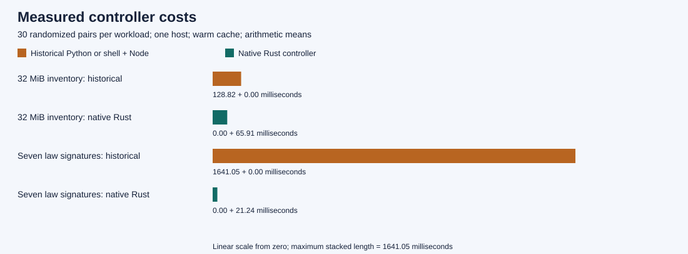
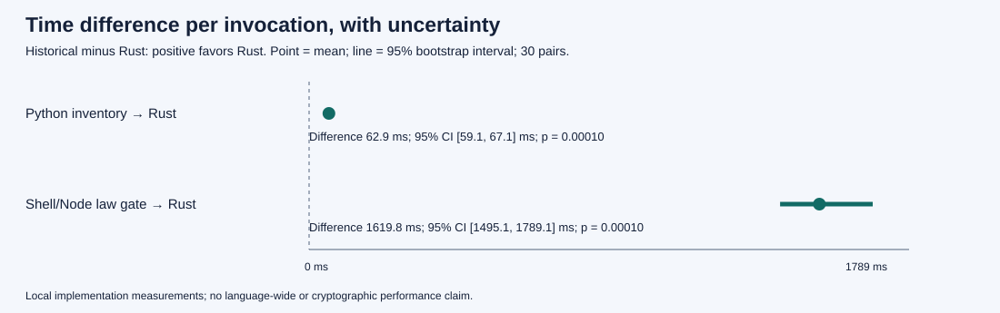
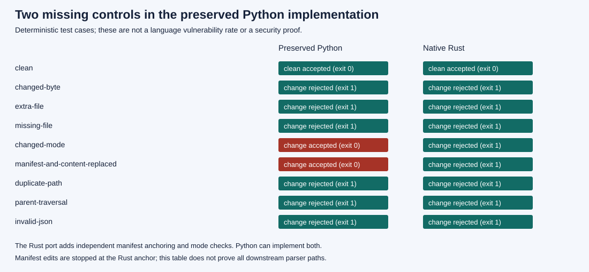
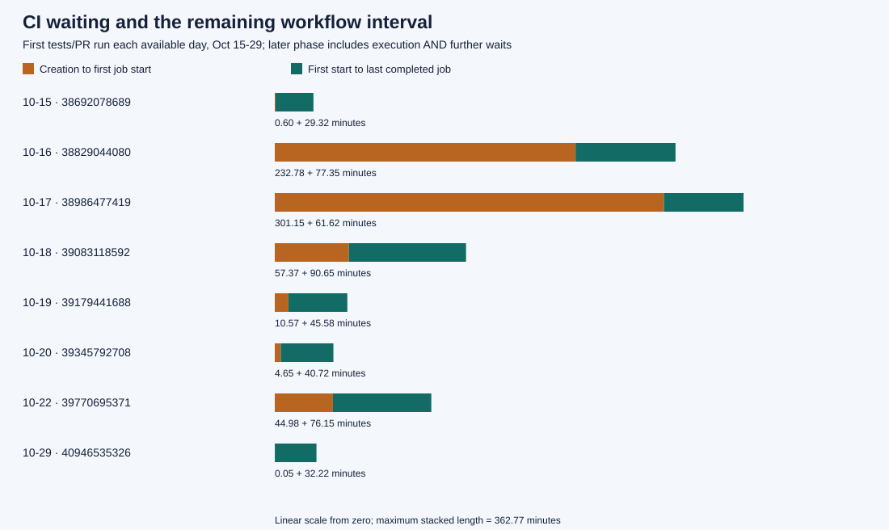
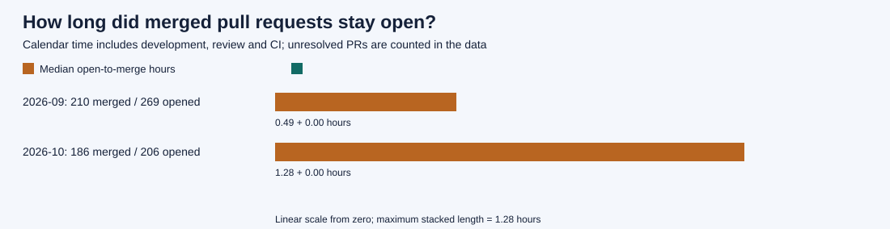

# Build audit: language choices, recovery controls and PR delays

**Status: measured local comparisons and public-history audit. No merge or rollout.**

The original Python recovery controller had no statistically valid comparison
justifying its language choice. That was a gap against the user's stated Rust-first
direction. The retained code also lacked an independent manifest anchor and file
mode checks. Those are concrete, reproducible implementation omissions. The Rust
replacement in [PR #496](https://github.com/beehive-nature/beehive-nature/pull/496)
adds both. The Python source and original reconstruction evidence remain preserved.

The CI history shows real delays and repeated work. It does **not** establish that
a programming language caused every delay, that the whole project ceased operating,
or that a provider deliberately targeted decentralized development. The user's
reported several lost workdays matter; no attributable time ledger or revenue data
in this audit can convert that report into measured financial damages.

This report supplies the missing narrow comparison and makes the remaining gaps
visible. It does not call an unmeasured claim a result.

## Read the graphs first

The performance graphs use the corrected same-filesystem experiment. A preliminary
run loaded Python from Windows storage while Rust ran from Linux storage. That
pilot is retained in the raw archive and excluded from the final comparison. A second pilot exposed a 105–108 ms floor in the external timeout utility. The final run uses Rust supervision; five no-op controls measured 1.38–1.88 ms and were not subtracted.

July and August have no PR records in the returned PR history. The earliest is
[PR #2, created September 7](https://github.com/beehive-nature/beehive-nature/pull/2).
That absence is **not zero development, zero delay or a disproof of the user's
July 4 instruction**. Git history contains earlier work. The exact July 4 language
instruction and an uninterrupted daily instruction history were not independently
reconstructed here. The retained August 10
[ruling](RULING_SEAT1_B1_PHASE0_DESIGN_2026-08-10.md) already identifies Python-versus-Rust
conformance coverage as a correctness gap; the October 8
[PQ specification](../specs/SPEC-BTUNGSTEN-PQ-1.md) explicitly requires Rust models
and tests of the same Rust. The current direction is Rust for active tooling,
C++ where the Vaulta-native boundary requires it, and HTML for presentation.

## What was measured

Source base: `e36fde447446440916131a2b4dadd1eee3bcc7d0`.
The independent branch is `codex/build-forensics-2026-10-29`, in
`C:\Users\travi\wt-codex-build-forensics`. PR #496 stays at
`9c7bd386e1c34374269e29811dd6b172720818b3`; its earlier accepted Python candidate
is `25c0a2f33bdde7ffe67fec4ad782026209fdc092`. No signer, harness, SDK, H01, B9,
wallet or shared workflow was edited by this audit.

The [Rust tool](../../tools/build-forensics/README.md) creates the test material,
collects public metadata, runs preserved comparators, calculates statistics and
generates standalone SVGs. Dependencies are exactly pinned in its standalone
Cargo.lock and compiled from retained vendor files with Rust 1.98.1, offline,
one compilation job at low priority. No new Python/Node implementation was added. Five local controls pass, including an actual hung-child deadline; Clippy passes with warnings denied. Cargo Audit reports zero advisories and zero warnings against freshly downloaded RustSec commit `ee1a49a2769a24a596afc1c20cb33748d2769586` (October 29); yanked-registry status was not checked.
The historical interpreters run only to measure the existing comparators.

Each workload has three warmups per implementation, then 30 pairs with randomized
order. Each child has a 30-second timeout. Both implementations and all measured
fixture files reside on the Linux filesystem in the final run. The benchmark runs
serially in a fresh network namespace, with the host mounted read-only except the
dedicated output directory. Live namespace observations show only loopback and no
external route. The SDK quiet-window process check found no matching active build
or timing process; it is an observation, not a reservation or a guarantee of an
otherwise idle machine. No complete signer reconstruction was rerun. The isolated build target occupies 148,766,239 bytes; the final corpus/run directory 33,665,419 bytes; the preparation API cache 12,778,173 bytes; and the advisory snapshot 2,722,649 bytes. Peak memory and total developer labor were not measured. The original multi-gigabyte recovery snapshot is reused, not duplicated by this audit.

| Workload | Historical implementation | Native Rust | Interpretation |
|---|---:|---:|---|
| Inventory 512 files / 32 MiB | 128.82 ms | 65.91 ms | 1.95× historical / Rust mean |
| Seven public law signatures plus tamper refusal | 1,641.05 ms | 21.24 ms | 77.27× historical / Rust mean |

Values are arithmetic mean elapsed milliseconds, including process startup and
the timeout supervisor. The Python inventory comparator invokes the original
`verify_snapshot` unchanged. The native version additionally hashes the independent
manifest anchor and checks mode bits. The law comparison is shell/Node orchestration
versus Rust orchestration; **both call the identical Rust bSigner binary**. This
does not compare Rust cryptography with Python or JavaScript cryptography.

Mean paired inventory saving: **62.90 ms**, 95% interval **[59.13, 67.11] ms**. Mean paired law-controller saving: **1,619.82 ms**, 95% interval **[1,495.06, 1,789.10] ms**. Each unadjusted sign-flip p-value is **0.00009999**; the two-comparison adjusted value is approximately **0.00020**.

Intervals use 10,000 paired bootstrap resamples. The two-sided paired sign-flip
test uses 10,000 Monte Carlo draws and the plus-one correction; its smallest
reportable p-value here is about 0.00010, never zero. Even after a two-comparison
Bonferroni correction, the reported differences meet a 0.05 threshold. This is
conditional evidence for these implementations on one host with warm caches.
There is no replication across hosts, operating systems or language implementations;
adjacent runs can share host conditions. It is not a universal language ranking.

## Security: demonstrated controls, not an invented safety percentage

Both implementations accepted the clean inventory and rejected altered bytes,
extra files, missing files, duplicate paths, traversal entries and malformed JSON.
The preserved Python verifier accepted changed permissions and a coherently replaced
file-plus-manifest. Rust rejected both. The latter needs a manifest digest obtained
independently of the potentially altered snapshot; placing it beside the snapshot
without separate trust would defeat the intended boundary.

These are eight chosen mutation cases, not a random population of attacks. There
is no statistically meaningful vulnerability rate, security p-value or “100% secure”
claim. Manifest edits stop at Rust's anchor, so those rows do not prove every
downstream parser defense. Python can implement these checks too: the demonstrated
cause is missing controls, not a language making them impossible. `forbid(unsafe_code)`
in this tool covers its own source, not its dependencies, operating system or FFI.

| Language / boundary | Evidence available here | What remains unmeasured |
|---|---|---|
| Rust native controller | Paired timings, altered-input controls, bounded execution, pinned build | Whole-stack security, scale and all-host performance |
| Preserved Python controller | Same public inventory workload and negative cases | Language-wide exploit rate or total project cost |
| Shell + Node controller | Same public law gate using the same signer | JavaScript cryptography versus Rust cryptography |
| C++ / Vaulta-native | Existing ownership boundary; no new implementation | A matched C++ benchmark; no invented result |
| HTML | Static report presentation, no script or remote dependency | It is markup, not an interchangeable controller implementation |

External evidence supports the Rust direction without replacing local evidence.
Google reports Android Rust memory-safety vulnerability density around 0.2 per
million lines, versus historical C/C++ around 1,000; it also reports about 25% less
review time and fourfold lower rollback rates for medium/large Rust changes.
These are Android observations with different code populations, not this repository,
not a Python comparison and not a randomized language trial. The article does not
provide raw per-change observations permitting an independent significance test.
[Google's primary report](https://blog.google/security/rust-in-android-move-fast-fix-things/).

Memory safety is not synonymous with “Rust versus every other language.” The
joint government roadmap also lists Python among memory-safe languages. That does
not establish Python's suitability for this project's bounded native execution
requirements. [Primary roadmap announcement](https://www.nsa.gov/Press-Room/Press-Releases-Statements/Press-Release-View/article/3608324/us-and-international-partners-issue-recommendations-to-secure-software-products/).

## What the bottleneck cost — and what cannot be priced

| Observed item | Measured quantity | What the number means |
|---|---:|---|
| Wallet job in run 39008052140 | 7,690 seconds waiting; 1,802 seconds executing | 128m10s before start; 30m02s executing; 81.0% of its creation-to-completion interval before start |
| Earliest tests/PR run on October 16 | 13,967 seconds before first job | 3h52m47s scheduling delay; not Python execution |
| Earliest tests/PR run on October 17 | 18,069 seconds before first job | 5h01m09s scheduling delay; not Python execution |
| Five duplicate feature-push proof workflows on one candidate | 2,776 summed job seconds across eight jobs | 46m16s of runner occupancy; not necessarily 46m16s extra PR elapsed time |
| Native recovery after replacing the Python controller | 264.421 seconds | Additional reconstruction/verification run, retained separately from the original 247.814-second run |
| Native controller build/tests/Clippy in that recovery lane | 35.08 + 21.73 + 21.85 seconds | Additional observed validation stages; excludes implementation labor and hosted CI |
| User's several lost workdays; lost revenue; provider bills | Not quantified | No attributable labor ledger, counterfactual or billing export supplied |

The five duplicated runs are 39179422708, 39179422712, 39179422723,
39179422737 and 39179422744. Fresh API job arithmetic reconciles the existing
[source-bound throughput receipt](../receipts/ci-throughput-2026-10-18/cache-pr-qualified.json).
The candidate's total was 23,946 summed job seconds: this identified duplicate
subset was 11.6%. These selected seconds cannot be multiplied across every commit
since July 4 without corresponding runs and workload coverage.

Earlier cache reporting also needed correction. A cache key hit did not establish
that a nested workspace's actual target directory had been restored. The October 18
[dispatch](2026-10-18-ci-throughput.md) records the path error and retracts the
stronger interpretation. The October 17 cold/warm observations are one pair with
other environmental variation, not a statistically valid language experiment.

The API collection contains **475 PRs**, **159 tests.yml PR-triggered runs** in
October 15–29, and **110 latest-attempt jobs across 20 selected runs**. The eight-day
sample chooses the earliest retained tests/PR run on each day with an available
record. Missing dates are not inserted as zero-delay successes. Selected historical
cases are kept separate from that deterministic sample. The fixed analytical cutoff
is October 30 at 05:03:43 UTC (October 29, 23:03:43 Denver).

| PR creation cohort | Opened | Merged by cutoff | Closed without merge | Unresolved | Median / p90 hours among merged |
|---|---:|---:|---:|---:|---:|
| September | 269 | 210 | 25 | 34 | 0.495 / 22.197 |
| October through cutoff | 206 | 186 | 6 | 14 | 1.280 / 47.776 |

The October median is about 2.59 times September's in the retained merged cohorts.
Different tasks, unresolved PRs, review, development, weekends and infrastructure
all affect these calendar durations. This is a descriptive comparison, not a
causal language or agent-policy effect. A dollar calculation needs the actual
runner class and billed rate; a human-loss calculation needs observed active/blocked
time and a defensible counterfactual. Neither is fabricated here.

## Competing explanations and the evidence needed to distinguish them

| Explanation | Evidence in this audit | Finding |
|---|---|---|
| Extra controller startup/runtime overhead | Randomized paired runs, fixed public inputs, identical signer | Measured for these implementations |
| Missing integrity checks | Two altered-input cases accepted by preserved Python | Reproduced; fixed in the retained Rust candidate |
| Duplicate scheduling and bad cache paths | Public runs, job times and the explicit cache correction | Documented engineering defects / inefficiency |
| Provider outage / shared infrastructure coupling | Official October 19 incident and contemporaneous queue reports | Plausible for overlapping affected work; does not explain October 16–17 waits |
| Local safety/approval blocks | One recovery conversation, 162 tool-output records, three exact pattern groups | No matching events found in that bounded snapshot; incomplete telemetry |
| Selective model access, anti-crypto targeting or intentional sabotage | No matched account/task cohorts, provider assignment logs or attributable policy decisions | Not established; cannot assign motive or damages |

GitHub reports an October 19 incident from 15:24–16:52 UTC, including delayed job
starts and status/log updates, following a shared network overload from cache
reconnection attempts. That is evidence of a centralized dependency failure.
The selected October 19 daily run began around 00:08 UTC, **before the outage**,
and its delay must not be assigned to that incident.
[Official incident record](https://www.githubstatus.com/incidents/8tzbpcnl75jp).

The [local trace summary](../receipts/build-forensics-2026-10-29/session-audit.json)
contains a snapshot digest, boundaries and search coverage. The raw trace stays
local because it contains conversation/environment data. The search does not cover
every refusal format, every session or every provider. No matches does not mean
zero harm. A credible differential-treatment study would require equivalent tasks,
model/version/effort and account-entitlement records, randomized or matched groups,
timestamps of policy decisions, outcomes and enough independent observations for
predefined power and uncertainty analysis. This audit has no such dataset.

## Corrections, failed attempts and preservation

The audit itself was not perfect on the first attempt. The record includes an
unused-import warning, a Clippy range-style rejection (fixed), a patch-context
mismatch (no edit applied), a shell quoting failure before the pilot launch, and a
pilot wrapper exit error after its JSON had been written. Those are reported as
failures, not passed gates. The final benchmark uses direct process arguments.

The first broad Actions collection stopped when a single day exceeded the API's
1,000-result search boundary. Its partial PR file and attempt record are retained.
The final collector deliberately measures the stated tests/PR window and historical
cases, adds local API caching and interval checkpoints, and completes with exit 0.
It is **not** presented as a complete July–October Actions census. The pilot's
filesystem confound prompted a same-filesystem repeat; neither pilot was erased.
Process-pattern namespace probes missed their targets; subsequent direct PID
observations captured each corrected benchmark namespace while it was running. A Windows hash read could not follow the timeout symlink; resolving its Linux target corrected that digest before publication. A direct Cargo lookup lacked the shell PATH; the installed tool was then invoked through its normal shell environment.

Full command outcomes, source/toolchain/binary digests, raw samples and collection
scope are in the [receipt index](../receipts/build-forensics-2026-10-29/README.md).
The original recovery snapshot, source archive, raw logs, independent integrity
references and Python files retain their original locations and bytes. This is an
engineering evidence package, not a representation of forensic legal admissibility.

## Prescribed direction and remaining acceptance

Rust is the active language for this lane's collection, analysis and measurement.
The report is HTML/Markdown/SVG with no hosted script, telemetry or remote font.
Offline measurement and analysis work without GitHub; GitHub is the requested
publication and historical evidence source. That does not make the repository's
existing hosted CI decentralized. Provider replacement, offline acceptance and
independent mirrors still need their own demonstrated gates.

The earlier language census identified 1,102 active script files across other
owners' surfaces. This audit does not relabel them migrated or silently rewrite
H01, B9, SDK, wallet consumers or shared workflows. A repository-wide conversion
needs an owner-bound inventory, contract fixtures and measured acceptance per
replacement; a bulk extension rename cannot provide it.

The estate's [bTunGsTeN standard](../specs/SPEC-BTUNGSTEN-1.md) requires measurable
decentralization, replaceability, bounded resources, sovereign authority and
continuity for at least 10 billion active unique humans across 1,000 years. This
audit handles public throwaway data, no custody, no credentials or private keys,
no payments and no production calls. It demonstrates two local controller
comparisons and a bounded historical analysis. The retained reconstruction remains
one source/toolchain/host reconstruction: no bit-for-bit reproducibility,
10-billion-user capacity or thousand-year durability is established.
